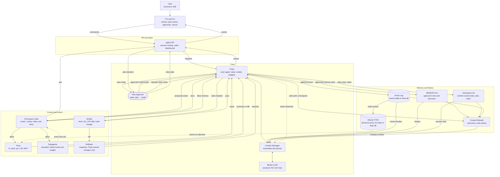

# Thais — Coding Agent Architecture (v2)

One diagram. Paste it in a Markdown viewer that supports Mermaid (GitHub, GitLab, Obsidian, VS Code).



`Agent API` is the only client-facing boundary for TUI, web, and IDE. The CLI is the local composition root: it hosts `thais serve`, exposes the client commands, and keeps the local admin commands (`doctor`, `auth`, `trust`). TUI, web, and IDE never import core packages or touch the database directly; they send commands and receive events through the API. `Plan Approval` is the only path from plan mode to build mode. `MEMORY.md` is written by Thais, not by a tool, and only after the gate's `allow memory` decision.

## Summary

Thais is a headless coding agent. It helps a user write code and runs an explicit loop: assemble, decide, authorize, act, verify, and persist. The model proposes a step. TUI, web, and IDE are clients of the Agent API; the CLI is the local composition root that hosts the server and exposes client commands. TUI, web, and IDE never call the core directly. Plans in plan mode go to the user for approval; approval switches to build mode, rejection returns to plan mode. Tool calls, subagent tasks, and memory writes go through the Permission Gate; final answers return through the API to the TUI. Until the OS sandbox lands, `bash` is always `ask`; the workspace path jail is not isolation. Tools or subagents execute approved actions. The Verifier checks only actions that changed code or project files, and Rollback restores Thais's own changes to the last good state on failure.

The Event Log is the source of truth: the `events` table in `thais.db`. `MEMORY.md` and `checkpoint.md` are curated stores: long-term approved rules and the current session state. The derived `events_fts` index lives in the same database, not in a second store. When the context approaches the token limit, the Context Manager signals Thais, which rebuilds at a safe point after a write-ahead checkpoint.

## Execution loop

| State | Owner | What happens | Exit |
|---|---|---|---|
| Intake | Thais | Receives the task, loads the checkpoint or starts a new one, opens a turn, and logs the event. | Assemble |
| Assemble | Context Manager | Builds the prompt from system rules, `MEMORY.md`, checkpoint, and the recent Event Log window. | Decide |
| Decide | Model | Returns one structured step: plan, zero or more tool calls, a subagent task, or a final answer. | Plan approval (plan mode), Assemble (build-mode plan), Authorize, or Persist |
| Plan approval (plan mode) | User through the TUI | Reviews the plan. Approval switches Thais to build mode; rejection returns to planning. | Assemble (approved) or Decide (rejected) |
| Authorize | Permission Gate | Applies the active mode and policy to every tool call, subagent task, and memory write. Allow executes; ask goes to the user; deny returns a reason. `bash` is always `ask` until M6. | Act, TUI (ask), or Decide (deny) |
| Act | Tools, Subagents, or Thais | Executes the batch. Read-only tool calls run in parallel; mutations are serialized. Every nested subagent tool call re-enters the gate. Memory writes are performed by Thais only after `allow memory`; results are appended to the log. | Verify (code changes) or Persist (read-only or memory writes) |
| Verify | Verifier | Runs tests, lint, and LSP checks, but only after an action that changed code or project files. Its commands pass through the Permission Gate. Memory and checkpoint writes skip verification. It returns pass, fail, or unavailable. | Persist (pass), Ask (permission or unavailable), or Rollback (fail) |
| Rollback | Rollback | Restores Thais's own changes from the last snapshot and decrements the repair budget. | Decide or Escalate |
| Persist | Thais | Writes the checkpoint, closes the turn, and checks iteration, token, cost, and time budgets. Events were already appended as they happened. | Assemble, Done, Failed, or Cancelled |

An `ask` answer returns to Thais, which re-enters Authorize for the same action. Approval never bypasses the gate. Thais derives the task list from the approved plan and updates it as actions complete; the model cannot write `checkpoint.md` directly. Plan approval applies in plan mode. In build mode, a plan is checkpointed and the loop returns to Assemble without a separate approval.

### Context rebuild

The Context Manager measures tokens before each model call and signals Thais when the configured threshold is reached. Thais then waits for a safe point — no in-flight tool and no pending approval — writes a checkpoint, and starts Context Rebuild. Context Rebuild reads `MEMORY.md`, `checkpoint.md`, and the Event Log, keeps the last N turns verbatim, summarizes older events, and returns a compact context. The rebuild itself is logged.

If the rebuild fails, Thais falls back to the checkpoint plus `MEMORY.md` and continues in a fresh context instead of losing the session.

## Parts

| Part | Description |
|---|---|
| User | The person who gives the task. |
| TUI and CLI | The text interface. It streams output, shows diffs, reviews plans, asks for approvals, and cancels. The TUI is a pure client; the CLI is the local composition root that hosts `serve` and admin commands. |
| Agent API | The only client-facing boundary. It routes sessions and commands, streams events, and serves JSON-RPC over stdio for local single-client use and WebSocket for multi-client daemon, web, and IDE clients (M7). |
| Thais | The main agent and orchestrator. It owns the loop state machine, the active mode, the budgets, the checkpoint, log, and approved memory writes, and the rebuild coordination. |
| Plan Approval (state) | The explicit state where the user approves or rejects the plan. Approval switches from plan mode to build mode; rejection returns to plan mode. |
| Context Manager | Builds the prompt, counts tokens, and signals the rebuild threshold. |
| Model (LLM) | The language model. It proposes the next structured step. |
| Permission Gate | Checks every model-proposed tool call, subagent task, or memory write against mode and policy: allow, ask, or deny. `bash` is always `ask` until M6; allow-always and prefix allowlists are disabled. |
| Tools | Read and edit files, run commands, use git, and call LSP and MCP servers. Read-only calls run in parallel; mutations are serialized. |
| Subagents | Bounded workers for one job. They inherit mode, workspace, and budget, and return a short summary and, when they changed files, a diff. |
| Verifier | Runs tests, lint, and LSP checks after a code change. Its commands come from user config or an explicitly trusted workspace, never from repo config alone, and pass through the Permission Gate. It returns pass, fail, or unavailable and is not in the path of read-only tools. |
| Rollback | Takes a snapshot before each code-changing action and restores Thais's own changes from it. It never discards pre-existing user changes. Bash changes are best-effort until the M0/M2 rollback spike closes. |
| Event Log | The `events` table in `thais.db`: append-only, runtime-written, and protected against `UPDATE` and `DELETE` by triggers. It records user messages, model steps, tool calls, results, permission decisions, and lifecycle transitions. |
| SQLite FTS5 | The derived `events_fts` index in the same `thais.db`. It can be rebuilt from the `events` table at any time. |
| MEMORY.md | Long-term file of approved rules and decisions. Thais writes it only after the gate approves the memory action. |
| checkpoint.md | Runtime-owned session file with the current state, the approved plan, and the task list. |
| Project config | `<repo>/.thais/config.toml` is untrusted, at the same trust level as project `AGENTS.md`. It cannot set or override providers, base URLs, auth, permissions, verifier commands, or sandbox level. |
| Workspace trust | Stored in Data (`workspace_trust`), keyed by canonical workspace path plus config hash; changing either invalidates trust. |
| Context Rebuild | Builds a compact context from `MEMORY.md`, `checkpoint.md`, and the Event Log at a safe point. |

## Links

| Link | Description |
|---|---|
| User → TUI and CLI | The user types a task, reviews the plan, or answers an approval request. |
| TUI and CLI → Agent API | The interface sends commands: task, action approval, plan decision, or cancellation. |
| Agent API → TUI and CLI | The API streams events: tokens, progress, results, questions, permission requests, and plan updates. |
| Agent API → Thais | The API dispatches a command to the session actor. |
| Thais → Agent API | Thais emits session events to the API. |
| Thais → Plan Approval | Thais hands the completed plan to the approval state. |
| Plan Approval → Agent API | The approval state sends the plan to the API. |
| Agent API → Plan Approval | The API routes the user's plan decision to the approval state. |
| Plan Approval → Thais | Approval switches to build mode; rejection returns to plan mode. |
| Thais ↔ Context Manager | Thais asks for the prompt. The manager updates the context and signals the token threshold. |
| Context Manager ↔ Model (LLM) | The manager sends the prompt. The model returns the next structured step. |
| Thais → Permission Gate | Thais submits every proposed tool call, subagent task, or memory write. |
| Permission Gate → Tools | The gate lets an allowed tool call reach the tools. |
| Permission Gate → Subagents | The gate lets an allowed subagent task reach the subagents. |
| Subagents ⇢ Permission Gate (dashed) | Each nested tool call of a subagent also goes through the gate. |
| Permission Gate → Agent API | An `ask` decision becomes a permission request event. |
| Permission Gate → Thais | A `deny` returns a reason for re-planning; an `allow memory` returns the approved rule for writing. |
| Tools → Thais | The tools return the result, the diff, or an error. |
| Thais → MEMORY.md | Thais writes the rule only after the gate's `allow memory` decision. |
| Subagents → Thais | Each subagent returns a short summary and, when applicable, a diff. |
| Thais → Verifier | A code-changing action goes to verification. Verifier commands pass through the gate; read-only and memory results skip this step. |
| Verifier → Thais | The verifier returns pass, fail, or unavailable. |
| Verifier → Rollback | A failed verification triggers a restore. |
| Rollback → Thais | The rollback returns the restored state and the failure details. |
| Thais → Event Log | Thais appends every event as it happens. |
| Thais → checkpoint.md | Thais writes the state, plan, and task list after each action that changes the task state. |
| Event Log → SQLite FTS5 | The `events` table is indexed into the derived `events_fts` table in the same `thais.db`. |
| SQLite FTS5 ⇢ Tools (dashed) | Tools search the history on demand. |
| Event Log → Context Manager | The log supplies the recent event window. |
| MEMORY.md → Context Manager | Approved rules are included in every prompt. |
| checkpoint.md → Context Manager | The checkpoint is loaded at session start. |
| Thais → Context Rebuild | Thais waits for a safe point, writes the checkpoint, and starts the rebuild. |
| Context Rebuild → Context Manager | The rebuild returns a smaller context to the manager. |
| MEMORY.md, checkpoint.md, Event Log → Context Rebuild | The rebuild reads all three stores. |

## Invariants

1. The Event Log is the `events` table in `thais.db`, append-only and written by the runtime, not by the model. Triggers reject `UPDATE` and `DELETE`. FTS5 is the derived `events_fts` index in the same database and must be rebuildable from `events`.
2. Model output, tool output, and retrieved history are untrusted data. The gate validates the step schema and the action arguments. No tool runs, and no `MEMORY.md` write happens, without a gate decision.
3. Plan mode denies mutations at the gate and at the tool layer. The only workspace writes allowed are the plan and the checkpoint; the Event Log continues to be appended by the runtime. The only transition from plan mode to build mode is through Plan Approval.
4. Subagents inherit mode, workspace, and budgets. They never bypass the gate and cannot spawn deeper than the configured depth.
5. The Verifier runs only after a code-changing mutation. A failure either repairs within budget or escalates. It never loops indefinitely.
6. `MEMORY.md` changes require approval and are recorded together with the approving decision.
7. `checkpoint.md` is written after every action that changes the task state and at a safe point before a rebuild. A crash or rebuild must not lose the current task.
8. Cancellation propagates to the model stream, tool process groups, and the subagent tree. State is checkpointed before exit.
9. Every loop has a budget for iterations, tokens, cost, and time. Exhausting it ends in `failed` or an explicit user decision, never in silence.
10. The workspace path jail is not a sandbox. Until the OS sandbox lands in M6, `bash` always requires `ask`; allow-always and prefix allowlists are disabled. Path traversal, network access, and secret exposure remain policy decisions, not model choices.
11. Secrets are redacted before an event is appended or a prompt is assembled. Raw credentials never enter the log, the search index, or the model context.
12. The Agent API is the only client-facing boundary. TUI, web, and IDE import only the protocol or client SDK; none of them imports core internals or reads SQLite, checkpoints, or memory files directly. The CLI is the local composition root: it hosts `thais serve` and the local admin commands (`doctor`, `auth`, `trust`), while its client commands use the API or SDK. stdout is protocol-only; logs go to stderr.
13. `<repo>/.thais/config.toml` is untrusted repository content, at the same trust level as project `AGENTS.md`. It cannot define or override providers, `base_url`, auth, permissions or policy, verifier commands, or sandbox level. Trust is stored in Data, keyed by canonical workspace path plus config hash. Project config cannot grant permissions or bypass the gate.
14. stdio is single-client. Multi-client per session is available only through the daemon and WebSocket (M7); approvals are first-wins and broadcast as `permission.resolved`.

## Failure and recovery

| Failure | Detection | Response |
|---|---|---|
| Model timeout or provider error | Provider error or deadline | Retry with backoff, use a fallback model if configured, then pause and ask the user. |
| Tool crash or timeout | Non-zero exit or deadline | Kill the process group, log stderr, restore known snapshots where possible, and return the error to Thais. |
| Permission denied | Gate decision `deny` | Return the reason. Thais re-plans and does not retry the same action unchanged. |
| Invalid model step | Schema validation in the gate or orchestrator | Return a structured error to the model, retry within budget, and escalate if it repeats. |
| Verification failure | Non-zero checks | Roll back, decrement the repair budget, and escalate with the diff when the budget reaches zero. |
| Verifier unavailable | Missing check command or tool | Mark the change `unverified`, log it, and continue only if policy allows; otherwise ask the user. |
| Context overflow | Token threshold in the Context Manager | Wait for a safe point, write the checkpoint, rebuild, and preserve the last turns. |
| User cancellation | Cancel signal from the TUI | Stop the stream, kill the tools, write the checkpoint, and return `cancelled`. |
| Budget exhausted | Iteration, token, cost, or time limit | Stop the loop, write the checkpoint, and ask the user whether to continue with a new budget. |
| Process crash | Startup finds a dirty checkpoint | Load the checkpoint and the log tail, mark interrupted actions, and restore known partial mutations where possible. |
| Rollback failure | Restore error | Stop the loop and escalate with the snapshot path and the failure details. |
| Bash change rollback | Snapshot/hash mismatch or missing before-state | Restore best-effort, mark the change `unverified`, and report paths that could not be restored. |
| Rebuild failure | Rebuild error | Fall back to checkpoint plus `MEMORY.md`, start a fresh context, and keep the session. |

## Decisions

| Decision | Default | Reason |
|---|---|---|
| Verifier scope | Code changes only | Read-only tools and memory writes have nothing to verify. This avoids cost and false repair loops. |
| Repair budget | 2 consecutive attempts per failed check | Bounded recovery. Thais escalates before it starts thrashing. |
| Tool batching and concurrency | Multiple tool calls per step; read-only calls in parallel, mutations serialized | Preserves snapshot and rollback ordering while allowing fast exploration. |
| Source of truth | Event Log (`events` table in `thais.db`) | Auditable and replayable. `events_fts` can be rebuilt. |
| Bash policy | Always `ask` until M6; no allow-always or prefix allowlists | The path jail is not a sandbox; bash must stay supervised. |
| Project config trust | Untrusted; trust in Data by path plus config hash | Prevents a repository from changing providers, policy, verifier commands, or sandbox level. |
| Verifier commands | User config or explicitly trusted workspace; always gated | Repo config alone cannot add test or lint commands. |
| Multi-client | Daemon/WebSocket only; stdio is single-client | Avoids ambiguous approvals over a single local pipe. |
| Bash rollback | Best-effort until the M0/M2 spike closes | Bash can change files outside known edit snapshots. |
| Checkpoint owner | Runtime | Survives crashes and rebuilds. The model cannot drift from the actual state. |
| Memory writes | Ask by default | Prevents persistent prompt injection and silent self-modification. |
| Subagent depth | 1 | Bounds cost and recursion. Deeper work is a deliberate configuration change. |
| Rebuild policy | Write-ahead checkpoint, keep the last 6 turns | Preserves in-flight intent that a summary would lose. |
| Plan approval (plan mode) | Explicit transition to build mode | Plan mode is read-only. Build starts only after the user approves the plan. |
| History retrieval | Explicit search tool | The model searches when it needs history. There is no hidden retrieval path. |
| Rollback scope | Thais-owned changes only | Protects uncommitted user work from being discarded. |
| MEMORY.md budget | Hard token cap, reviewed periodically | Keeps long-term rules from becoming a second context problem. |
| Log redaction | Secrets redacted before append | Keeps credentials out of history, the index, and prompts. |
| Session lease | One mutating session per workspace; many read-only sessions | Prevents concurrent edits and lost rollback state. |
| Model policy | Default plus roles (`plan`, `build`, `explore`, `general`, `compact`) with logged fallback | Matches the model to the job without hiding a switch. |
| Launch providers | OpenAI, Anthropic (native Messages API), OpenRouter, DeepSeek | Validates a useful spread before Qwen, Z.ai, and local presets. |
| LiteLLM | Optional `openai-compatible` endpoint; never the default layer | Keeps native control of tools, thinking, usage, and errors. |
| Second client | VS Code extension for v1; web UI post-v1 | Reuses the daemon and API and fits the coding workflow. |
| Session retention | Archive indefinitely; explicit delete only | Local-first data is not expired behind the user's back. |
| Telemetry | None in v1 | No usage data leaves the machine. |
| Sandbox default | Enforce where available; explicit opt-out | Secure by default; bash stays `ask`-only when the sandbox is off. |
| Credential fallback | Environment, then keyring, then `0600` file with warning | Supports CI and headless use without hiding the risk. |
| Instruction files | Global and project-root `AGENTS.md`; project wins; `MEMORY.md` below both | Keeps human instructions and learned rules separate. |
| Environment badge | Relativized paths, allowlisted variables, refresh on session start, workspace change, or manual command | Saves tool calls without leaking identity or secrets. |
| TUI wide tables | Horizontal scroll; plain-text fallback below a minimum width | Preserves columns and stays readable on narrow terminals. |
| Developer workflow | `Makefile` as the single entry point; `~/.local` install prefix | Consistent local and CI behavior without requiring root. |

The detailed record is in [`docs/adr/`](docs/adr/), and [ROADMAP.md](ROADMAP.md#decisions) keeps the v1 decision index.

## What changed from v1

| v1 | v2 |
|---|---|
| Tool output had no explicit path back to the model; it was assumed to pass through the Verifier. | Tool output returns to Thais and is logged. The Verifier is conditional. |
| The TUI talked directly to the agent. | The TUI talks only to the Agent API; the core is headless and replaceable. |
| Every result went through the Verifier. | Only code changes are verified, with rollback and a repair budget. |
| The rebuild had no trigger and ignored the live conversation. | The Context Manager signals the threshold; Thais rebuilds at a safe point after a write-ahead checkpoint, preserving recent turns. |
| In v1, Thais wrote `MEMORY.md` directly. | Thais writes it only after the gate approves the memory action. |
| Plan mode had no transition to build. | Plan approval is an explicit state; build starts only after the user approves. |
| `ask`, cancel, and streaming had no paths. | The gate asks through the TUI, cancel returns to Thais, and Thais streams back. |
| SQLite held the history. | The Event Log is the source of truth. SQLite FTS5 is derived. |
| The log could persist anything a tool printed, including secrets. | Secrets are redacted before the log, the index, and the prompt. |
| There was no trust boundary beyond the gate. | Model output is untrusted, memories are gated, tools run inside a workspace path jail, and bash is always `ask` until M6. |
| There was no termination or failure model. | The loop has explicit states, budgets, and a failure table. |
| The checkpoint was read only at rebuild. | It is loaded at session start and written after every action that changes the task state. |

## What changed from v2

| v2 | Current |
|---|---|
| Stack was open. | Rust stable is the implementation language; the architecture contract is unchanged. |
| The path jail was treated as a sandbox. | The path jail is not isolation; `bash` is always `ask` until M6. |
| Project config was implicitly trusted. | Project config is untrusted; trust lives in Data by path plus config hash. |
| Verifier commands were implicitly trusted from project config. | Verifier commands come from user config or a trusted workspace and pass through the gate. |
| stdio could imply multiple clients. | stdio is single-client; multi-client is daemon/WebSocket only (M7). |
| One tool call per model step. | Multiple tool calls per step; read-only in parallel, mutations serialized. |
| Event Log and FTS5 looked like separate stores. | Both live in `thais.db`: `events` table plus derived `events_fts` index. |
| Bash rollback was assumed to be complete. | Bash rollback is best-effort until the M0/M2 spike closes. |
| The roadmap had no early feedback gate. | Alpha = M0 + M1 + M2 + simple checkpoint, a daily-use feedback gate. |
| Several v1 questions were left open. | They are closed as ADRs; the Decisions table links each one. |

## Development

The workspace is a Rust workspace with a single `thais` binary and a
`docs/` tree for the protocol and decision records.

| Command | Purpose |
|---|---|
| `make` | Setup, check, and release build |
| `make check` | Format check, clippy, tests, and the architecture boundary |
| `make run ARGS="run --task hello"` | Run the fake-provider M0 flow |
| `make tui PROVIDER=cohere` | Open the TUI with the real Cohere provider (`make tui cohere` also works) |
| `make tui cohere MODE=plan` | Start the TUI in plan mode; approval switches to build |
| `make run ARGS="doctor"` | Validate paths, permissions, keyring, and FTS5 |
| `make tools` | Install `cargo-nextest`, `cargo-audit`, and `cargo-deny` |
| `make install PREFIX=...` | Install the binary; `make uninstall` removes only the binary |

User-level state lives under the home directory and follows the XDG layout on
Linux: `~/.config/thais`, `~/.local/share/thais`, `~/.local/state/thais`, and
`~/.cache/thais` (with native equivalents on macOS and Windows). Project
content lives in `<repo>/.thais/`. The `path = "../..."` entries in Cargo
manifests are internal workspace dependencies, not configuration paths.

The wire protocol is documented in [docs/protocol.md](docs/protocol.md). The
M0 rollback spike is documented in
[docs/spikes/rollback.md](docs/spikes/rollback.md).

### Real provider and TUI (M1)

The fake provider remains the default. The M1 real provider is Cohere through
its OpenAI-compatible endpoint. The key is read from the environment and is
never written to the repository or logs:

```sh
export THAIS_COHERE_API_KEY="..."
thais run --provider cohere --task "Find where Runtime is defined and cite the file"
thais tui --provider cohere
```

The TUI keys are: `Enter` send, `Esc` cancel the active turn (or quit when idle),
`PageUp`/`PageDown` scroll, `Ctrl+C` quit, and `y`/`n` for approval prompts.
The headless `thais run` command prints model text to stdout and logs to stderr;
`--json` emits the NDJSON event stream.

### M2 build safety

- Plan mode: `thais run --mode plan` or `thais tui --mode plan`. A completed
  plan asks for approval; approval is the only transition to build mode.
- Build mutations (`write`, `edit`, `apply_patch`) ask with a diff preview.
  `bash` always asks until M6.
- Before every mutation the runtime writes a shadow-Git snapshot. On tool
  failure or verifier failure it restores that snapshot and reports what was
  rolled back.
- The verifier reads user configuration from
  `~/.config/thais/verifier.toml`; copy
  [docs/verifier.example.toml](docs/verifier.example.toml) as a starting point.
  Project config cannot supply verifier commands. Without a config, mutations
  are marked unverified.
- Snapshots honor `.gitignore`; changes to ignored files are a known
  best-effort limitation. Bash can still write outside the path jail because it
  is not an OS sandbox, so every bash call requires approval.
- Personality: edit [PERSONALITY.md](PERSONALITY.md) for this project, or
  `~/.config/thais/PERSONALITY.md` for all projects. Personality shapes tone
  and style but never overrides safety, the gate, or the workspace jail.

## Out of scope

This document defines behavior, not libraries. The implementation language is Rust and the storage engine is SQLite WAL + FTS5; the UI framework, provider SDK details, and deployment model remain implementation choices. Telemetry, a web UI, and automatic session expiry are out of scope for v1.

See [ROADMAP.md](ROADMAP.md) for milestones, the Alpha gate, and delivery estimates.
