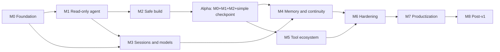

# Thais Roadmap

| Field | Value |
|---|---|
| Status | Draft |
| Last updated | 2026-10-23 |
| Architecture | [README.md](README.md) |
| Agent | Thais |
| Target | Alpha first, then v1.0: local-first coding agent |

## Vision

Thais is a local-first coding agent with a headless core and API-only clients. It can plan, edit, verify, and recover, while the user keeps control through explicit permissions, sessions, and model selection.

The core never imports a TUI, web framework, or IDE SDK. TUI, CLI, web, and IDE are clients of the same versioned protocol.

## Core and client boundary

Thais runs as a headless core. Clients never import core packages and never read storage directly; they only speak the Agent API.

| Client | Transport | Notes |
|---|---|---|
| TUI and CLI | stdio JSON-RPC | Local process, no port, single client |
| Web and IDE | WebSocket JSON-RPC | Localhost daemon with token auth, multi-client per session (M7) |
| Tests | In-process transport | Same protocol, no direct core calls |

Rules:

- The API is the only path into the core. TUI, CLI, web, and IDE are clients.
- stdio is single-client. Multi-client per session is a daemon/WebSocket feature delivered in M7.
- Core packages never import UI frameworks or IDE SDKs.
- Clients never read SQLite, checkpoints, or `MEMORY.md` directly.
- stdout is protocol-only; logs go to stderr.
- CI runs `cargo tree -p thais-tui` and fails if it depends on `thais-core`.
- The Session Manager, model policy, and provider adapters live behind the API; they are not UI concerns.

## Product principles

1. **Headless core.** The agent runs without a UI and exposes a versioned API.
2. **Event log is the source of truth.** Every event is append-only; SQLite FTS5 is derived and rebuildable.
3. **Every action is gated.** Tool calls, subagent tasks, and memory writes pass through the Permission Gate.
4. **Verify code changes.** The Verifier runs after code mutations, and Rollback restores only Thais-owned changes.
5. **Sessions are first-class.** Each session has its own context, checkpoint, budgets, and event stream.
6. **Models are explicit.** The model policy is per session and per role; fallback is logged, never silent.
7. **Local-first and secure by default.** Workspace confinement, secret redaction, keyring auth, and least privilege.
8. **Ship the loop before the ecosystem.** A reliable loop with a TUI beats a broad but fragile feature set.

## Scope of v1

- Create, resume, list, rename, archive, and explicitly delete sessions; sessions are archived indefinitely.
- One mutating session per workspace with an exclusive lease; multiple read-only sessions.
- Plan and build modes with explicit Plan Approval.
- Read, edit, patch, and run commands with permission prompts and diffs; bash is always `ask` until M6.
- Verifier for tests, lint, and typecheck using user-approved or explicitly trusted workspace commands; rollback with a repair budget.
- Model selection by role with fallback, usage, and cost tracking; launch providers are OpenAI, Anthropic, OpenRouter, and DeepSeek.
- Project `MEMORY.md`, per-session `checkpoint.md`, and context rebuild.
- History search over the `events` table with the derived `events_fts` index in `thais.db`.
- LSP diagnostics and MCP tools.
- Explore and general subagents with bounded budgets.
- TUI plus a VS Code extension using the same API.
- Installable binaries for Linux, macOS, and Windows.
- No telemetry in v1.

Alpha is the first usable slice: M0 + M1 + M2 + a simple checkpoint. The remaining items follow Alpha, not before it.

## Non-goals for v1

- Multi-user server, cloud sync, or team workspaces.
- A plugin marketplace or custom agent DSL.
- Automatic model routing based on benchmarks.
- Semantic/embedding memory.
- Full IDE replacement.
- Unattended long-running autonomy without approvals.
- Local model providers as a release blocker.
- A web UI in v1; it is a post-v1 candidate.
- Telemetry or analytics in v1.

## Technical baseline

| Layer | Choice |
|---|---|
| Core | Rust stable, edition 2024 |
| Async runtime | Tokio |
| Protocol | JSON-RPC 2.0 over stdio and WebSocket |
| Serialization | serde, serde_json, toml |
| Logging | tracing, tracing-subscriber |
| TUI | Ratatui + Crossterm; Markdown renderer selected by spike |
| Web/IDE | TypeScript + React for web, or a VS Code extension; one client for v1 |
| Storage | SQLite WAL + FTS5 (`rusqlite` with `bundled-full`, or `sqlx`) |
| CLI | Clap + Figment or `config` |
| HTTP/SSE | Reqwest + `eventsource-stream` |
| LLM | Native OpenAI/Anthropic adapters via Reqwest; OpenAI-compatible adapter for other providers |
| MCP | `rmcp` |
| LSP | `async-lsp` + `lsp-types` |
| Processes | `tokio::process`, `nix`/`windows-sys`, `portable-pty` |
| Paths | XDG via `directories` or `etcetera` |
| Credentials | `keyring` crate; 0600 fallback; environment variables for CI |
| Testing | `cargo-nextest`, `insta`, `wiremock`, `proptest` |
| Packaging | `cargo-dist`, Homebrew, Scoop, Docker |

Rust is the decided stack. The specific crates are starting points to validate in M0 spikes on SQLite FTS5, PTY on Windows, and provider streaming.

## Developer workflow

A single `Makefile` is the entry point. Targets are language-agnostic; the commands map to the chosen stack.

| Target | Command |
|---|---|
| `make` | `setup`, `check`, `build` |
| `make check` | `lint`, `test` |
| `make setup` | Check Rust toolchain, install `clippy`/`rustfmt`/`cargo-nextest`, fetch dependencies |
| `make fmt` | `cargo fmt` |
| `make lint` | `cargo fmt --check`, `cargo clippy --all-targets -- -D warnings` |
| `make test` | `cargo nextest run` with `cargo test` fallback |
| `make build` | `cargo build --release` |
| `make run` | `cargo run -- $(ARGS)` |
| `make install` | Build, then `install -m 0755 target/release/thais $(BINDIR)/thais` |
| `make uninstall` | Remove `$(BINDIR)/$(BIN)` |
| `make clean` | `cargo clean` and remove `dist/` |
| `make ci` | Non-interactive `setup check build` |
| `make audit` | `cargo audit`, `cargo deny check` |
| `make doctor` | Run `target/release/thais doctor` |
| `make help` | Parse target comments |

Rules:

- Variables: `BIN ?= thais`, `PREFIX ?= $(HOME)/.local`, `BINDIR ?= $(PREFIX)/bin`, `ARGS ?=`.
- `make lint` is read-only. `make fmt` rewrites files.
- `make` is the safe default: setup, format check, lint, test, and build.
- `make ci` is the single source of truth; CI calls it instead of duplicating commands.
- Use `mkdir -p $(BINDIR)` and `install -m 0755`, not GNU-only `install -D`, so macOS/BSD work.
- `make install PREFIX=/usr/local` may need `sudo`; do not put `sudo` inside the Makefile.
- `make uninstall` removes the binary only. Configuration, credentials, sessions, and memory are preserved; print a note.
- Include `.PHONY` targets and keep a `make help` that lists every target.
- Use `.editorconfig` to enforce tabs in the `Makefile`.
- Pin the toolchain with `rust-toolchain.toml`.
- Windows uses Git Bash or WSL for v1; a native equivalent is a later task.
- Build metadata (version, commit, date) comes from `vergen` or a build script.

## Storage and credentials

### Directory layout

Thais follows the XDG base directory convention on Linux and the native equivalents on macOS and Windows.

| Purpose | Linux | macOS | Windows | Contents |
|---|---|---|---|---|
| Config | `~/.config/thais/` | `~/Library/Application Support/Thais/config/` | `%APPDATA%\Thais\config\` | `config.toml`, `providers.toml`, `models.toml`; no secrets |
| Data | `~/.local/share/thais/` | `~/Library/Application Support/Thais/data/` | `%LOCALAPPDATA%\Thais\data\` | `thais.db`, workspace trust, `sessions/`, `snapshots/`, plugins |
| State | `~/.local/state/thais/` | `~/Library/Logs/Thais/` | `%LOCALAPPDATA%\Thais\state\` | logs, crash reports, diagnostics |
| Cache | `~/.cache/thais/` | `~/Library/Caches/Thais/` | `%LOCALAPPDATA%\Thais\cache\` | downloads, model catalog cache, rebuildable artifacts |
| Project | `<repo>/.thais/` | `<repo>/.thais/` | `<repo>\.thais\` | untrusted project `config.toml`, `MEMORY.md` |

Rules:

- Respect `XDG_CONFIG_HOME`, `XDG_DATA_HOME`, `XDG_STATE_HOME`, and `XDG_CACHE_HOME`.
- Create directories with mode `0700` and secret files with mode `0600`.
- Use atomic writes (temporary file plus rename) and do not follow symlinks when writing secrets.
- `MEMORY.md` is project-scoped and may be committed. Session checkpoints and event logs live under data and are not committed.
- `~/.cache/thais/` is safe to delete; Thais rebuilds anything it needs.
- `thais doctor` validates paths, permissions, keyring availability, and SQLite FTS5.
- `<repo>/.thais/config.toml` is untrusted repository content. It cannot set or override providers, `base_url`, auth, permissions or policy, verifier commands, or sandbox level.
- Security-sensitive settings come only from user config, environment variables, flags, or an explicit workspace trust.
- Trust lives in Data, in the `workspace_trust` table, keyed by canonical workspace path plus the config hash. Changing either invalidates the record.
- Project config may only provide non-security preferences; user config wins on conflicts.

The database layout is:

```text
~/.local/share/thais/
  thais.db                    # sessions, events, approvals, snapshots metadata, workspace_trust
  sessions/<session_id>/
    checkpoint.md             # runtime-owned state, plan, tasks
  snapshots/                  # Thais-owned file snapshots for rollback
```

`thais.db` contains the `events` table, which is the Event Log. `events_fts` is a derived FTS5 index over that table in the same database. Triggers reject `UPDATE` and `DELETE` on `events`.

### Credentials

API keys never live in `config.toml`, `providers.toml`, `models.toml`, project config, events, prompts, or snapshots.

| Priority | Store | Notes |
|---|---|---|
| 1 | Environment | `THAIS_<PROVIDER>_API_KEY` for CI, headless use, and explicit overrides |
| 2 | OS keyring | Secret Service/libsecret on Linux, Keychain on macOS, Credential Manager on Windows |
| 3 | 0600 file | `~/.config/thais/credentials.toml`, only when the keyring is unavailable; warn on use |

Rules:

- Keyring service is `thais`; account is `<provider>:<account>`, for example `anthropic:default`.
- Precedence is environment, then keyring, then the 0600 file. Keep this order stable and documented.
- `thais auth login <provider>`, `thais auth logout`, and `thais auth status` manage credentials.
- Never print a full key. Show a fingerprint or the last four characters only.
- `providers.toml` stores only non-secret provider configuration: id, type, base URL, organization, enabled, and auth source.
- `models.toml` stores model overrides and aliases. Capabilities and cost come from the built-in catalog plus overrides.
- Support multiple accounts per provider through the account label.
- Tests use a fake keyring and a temporary XDG root; never touch the developer's real keyring.
- `thais doctor` reports the keyring backend and whether the fallback is active.

## Model providers

Multi-model support is a provider adapter layer, not a single universal request. `/chat/completions` over SSE is the common socket; provider-specific options live in a validated `extra` map. Native APIs such as Anthropic Messages get their own adapter instead of being forced through an OpenAI-compatible shape.

### Provider trait

```rust
#[async_trait::async_trait]
pub trait Provider: Send + Sync {
    fn id(&self) -> &str;
    async fn models(&self) -> Result<Vec<Model>, ProviderError>;
    async fn chat(
        &self,
        request: Request,
    ) -> Result<BoxStream<'static, Result<Event, ProviderError>>, ProviderError>;
}
```

`Request` carries model, messages, tools, temperature, reasoning, and `extra`. `Event` carries content, reasoning, tool-call deltas, usage, errors, and done. Adapters normalize provider differences; the session layer never sees raw provider payloads.

### Adapters and presets

| Type | Use |
|---|---|
| `openai` | OpenAI native API |
| `anthropic` | Anthropic native Messages API and thinking blocks |
| `openai-compatible` | DeepSeek, OpenRouter, Qwen/DashScope, Z.ai/GLM, vLLM, Ollama |
| `litellm` | Optional local proxy for users who want one normalized schema |

Launch-validated adapters and presets: `openai` and `anthropic` (native), `openrouter` and `deepseek` (`openai-compatible`). Additional presets: `qwen`, `zai`, `ollama`, `vllm`, `litellm`, and `custom-openai-compatible`; they ship after launch and are not a v1 blocker. See [ADR-0003](docs/adr/0003-provider-adapters-and-launch-providers.md) and [ADR-0004](docs/adr/0004-litellm.md).

Presets are defaults, not contracts. A user can override the base URL, headers, models, capabilities, and `extra` without writing an adapter.

### Provider configuration

`providers.toml` contains no secrets:

```toml
[[providers]]
id = "deepseek"
type = "openai-compatible"
base_url = "https://api.deepseek.com/v1"
auth = "keyring:deepseek:default"
models = ["deepseek-chat", "deepseek-reasoner"]
extra = { thinking = { type = "enabled" } }
```

- `auth` is a reference such as `keyring:deepseek:default` or `env:DEEPSEEK_API_KEY`, never the key itself.
- `models.toml` stores model overrides, aliases, capabilities, context windows, and costs.
- Precedence for non-security settings: built-in preset, then user config, then project config for non-security overrides, then flags and environment.
- Providers, `base_url`, auth, permissions or policy, verifier commands, and sandbox level are never read from project config. They come from user config, environment or flags, or an explicit workspace trust.
- Secrets are never allowed in project config, provider config, model config, events, prompts, or snapshots.

### Extra parameters and reasoning

The `extra` map is merged in this order: adapter defaults, provider `extra`, model `extra`, per-request override. Unknown parameters are allowed but warned about, because providers add options faster than Thais can ship adapters.

Reasoning/thinking parameters are provider-specific. Examples, not a stable contract:

| Provider | Common `extra` |
|---|---|
| OpenAI | `reasoning_effort = "low"`, `"medium"`, or `"high"` |
| OpenRouter | `reasoning = { effort = "high" }` or `{ enabled = false }` |
| DeepSeek | `thinking = { type = "enabled" }` or `{ type = "disabled" }` |
| Qwen (DashScope) | `enable_thinking = false` |
| vLLM / Qwen local | `chat_template_kwargs = { enable_thinking = false }` |
| Anthropic | `thinking = { type = "enabled", budget_tokens = 2000 }` |
| Z.ai (GLM) | `thinking = { type = "disabled" }` |

Rules:

- Normalize internal reasoning fields (`enabled`, `effort`, `budget_tokens`) and let each adapter translate them.
- Capability flags decide whether a field is sent. Reasoning models that reject `temperature` must not receive it.
- A provider `400` is surfaced with the redacted response body; invalid parameters must not be silently dropped.
- Thinking output is a separate event stream (`reasoning.delta`) so the TUI can collapse it or show it dimmed.
- Provider docs change; keep mappings in presets and cover them with contract tests.

### SSE normalization

The OpenAI-compatible adapter must handle real-world SSE:

- `data:` lines, `[DONE]`, comments, keepalives, CRLF, and chunk boundaries.
- UTF-8 split across chunks; parse bytes, not lossy strings.
- `delta.content`, `delta.reasoning_content`, `delta.reasoning`, and provider-specific thinking fields.
- Tool-call deltas accumulated by index, with partial JSON arguments.
- Usage chunks, finish reasons, and provider error payloads inside the stream.
- Cancellation closes the HTTP body and stops the reader.
- Timeouts for first token, idle stream, and total request.
- Recorded SSE fixtures per provider for contract tests.

### LiteLLM

LiteLLM is supported as an optional `openai-compatible` endpoint. It is useful for users who want one schema across many providers. It is not required and must not become the only way to use a provider: native adapters keep control over tools, thinking blocks, usage, and provider-specific errors.

## TUI rendering

The TUI is a client of the API, but rendering quality is part of the product. The transcript must handle streaming Markdown, tables, code blocks, diffs, and long sessions.

### Requirements

- Accumulate streamed text and redraw on a throttled cadence, not on every token.
- Preserve the user's scroll position. Auto-scroll only when the user is at the bottom; pause on manual scroll and offer a resume key.
- Render headings, lists, tables, code blocks, inline code, and links.
- Strip an outer fenced block labeled `markdown` that models sometimes wrap around the whole answer.
- Handle unclosed code fences gracefully while streaming.
- Handle terminal resize and narrow widths; use horizontal scroll for wide tables and fall back to plain text below a minimum width ([ADR-0012](docs/adr/0012-tui-wide-tables.md)).
- Use display width, not byte or rune count, for wrapping and table columns.
- Keep tool-call cards, diffs, approval modals, and the status bar outside the Markdown transcript.
- For long sessions, window or virtualize the transcript and avoid re-parsing the entire history on every frame.

### Options

| Concern | Choice |
|---|---|
| Framework | Ratatui + Crossterm |
| Markdown | `tui-markdown` or `ratatui-markdown` (spike) |
| Tables | `tui-markdown` table renderer or `pulldown-cmark` direct |
| Scroll | Paragraph scroll or a custom viewport |
| Streaming | Throttled re-render |

- `tui-markdown` has an experimental table renderer; test narrow terminals, wide cells, and borders.
- `ratatui-markdown` is heavier but includes tables, syntax highlighting, scroll widgets, and Mermaid.
- `pulldown-cmark` direct gives full control at the cost of more code.
- The core and TUI are Rust. The Markdown renderer is selected by a spike before M1.

### Acceptance for the TUI spike

- Stream a long Markdown response with a table and a code block without flicker.
- Resize the terminal while streaming.
- Scroll up during streaming without being forced back to the bottom.
- Render a narrow table without breaking the layout.
- Keep input latency acceptable after 10k lines of transcript.

## Environment badge and instruction files

### Environment badge

At session start, Thais builds a compact environment badge and includes it in the system prompt. It avoids spending tool calls on facts that rarely change.

| Field | Example | Notes |
|---|---|---|
| OS | Arch Linux rolling | Name, version, kernel, architecture |
| Shell | `/usr/bin/zsh` | Allowlisted environment variable |
| Workspace | Project root | Relative to home when possible |
| Git | Repository, branch, dirty state | Commands with timeout and no prompts |
| CPU/RAM | 8 threads, 16 GB | Coarse values are enough |
| Tools | git, rg, cargo, node | `which`/PATH allowlist |
| Project markers | Cargo.toml, package.json, Makefile | Detected from the workspace |
| Date | 2026-10-23, Friday | Local timezone |

```text
<env>
os: Arch Linux rolling, kernel 6.x, x86_64
shell: /usr/bin/zsh
cwd: ~/projects/thais
git: repository yes, branch main, dirty no
cpu: 8 threads, ram: 16 GB
tools: git, rg, cargo, node, gcc
project: Cargo.toml, Makefile
date: 2026-10-23, Friday
</env>
```

Rules:

- Use an allowlist of environment variables. Never dump the full environment.
- Never include API keys, tokens, proxy credentials, SSH agent sockets, or cloud metadata.
- Relativize paths and avoid sending the username or home directory by default.
- Cache the badge and refresh it on session start, workspace change, or `thais env refresh`.
- Git commands have a timeout and never prompt interactively.
- Keep the badge within a small token budget; truncate the tool list rather than the OS and workspace facts.
- The badge is a cache, not a replacement for `bash`; Thais can still discover missing or stale facts.
- Treat the badge as data, not instructions.
- Rust uses `sysinfo`, `which`, and `chrono`.

### Instruction files

- Global instructions: `~/.config/thais/AGENTS.md`.
- Project instructions: `<repo>/AGENTS.md`, committed with the project.
- `AGENTS.md` is human-authored. `MEMORY.md` is agent-learned and approved; they are not the same file.
- Nested per-directory `AGENTS.md` files are a later extension; v1 loads the project root and the global file.
- Precedence for conflicting instructions: safety invariants, then project `AGENTS.md`, then global `AGENTS.md`, then `MEMORY.md`, then the session checkpoint and task state.
- Load at session start, reload on file change or an explicit command, and show which files were loaded in the UI.
- Enforce a size cap and token budget. Warn instead of silently truncating.
- Treat project `AGENTS.md` as untrusted repository content for security. It can guide behavior, but it cannot override the gate, sandbox, approvals, or secret policy.
- Merge sections with explicit labels instead of raw string concatenation.

### Prompt assembly order

1. Safety and system invariants.
2. Environment badge as labeled data.
3. Global `AGENTS.md`.
4. Project `AGENTS.md`.
5. `MEMORY.md`.
6. Session checkpoint and task state.
7. Recent event window and retrieved history.

The model sees the environment as data, not as a source of instructions. Project instructions take precedence over global instructions, but never over safety.

## Milestone map



M3 can run in parallel with M2 after M1. The critical path is M0 → M1 → M2 → Alpha → M4 → M6 → M7. Alpha is the first daily-use release and the feedback gate.

## Status

| Milestone | Status | Indicative effort |
|---|---|---|
| M0 Foundation | In progress | 2–3 weeks |
| M1 Read-only agent | Planned | 3–5 weeks |
| M2 Safe build | Planned | 5–7 weeks |
| Alpha: M0 + M1 + M2 + simple checkpoint | Planned | 12–18 weeks cumulative |
| M3 Sessions and models | Planned | 4–6 weeks |
| M4 Memory and continuity | Planned | 3–5 weeks |
| M5 Tool ecosystem | Planned | 5–7 weeks |
| M6 Hardening | Planned | 5–7 weeks |
| M7 Productization | Planned | 6–9 weeks |
| M8 Post-v1 | Planned | Continuous |

Estimates assume one developer with systems experience but new to Rust and this codebase. Ranges include a learning buffer of roughly 50% and are not commitments. The Alpha estimate is cumulative, not additive. Adjust after M0.

## Current focus

**M0 — Foundation → Alpha.** Do not start M1 until the protocol handshake, event log, fake provider, and architecture boundary tests pass. The v1 decision set is closed; see [Decisions](#decisions). The M0 workspace, protocol, storage, fake runtime, CLI, and test harness are implemented; `make ci` is the gate.

Alpha is the first daily-use release: M0 + M1 + M2 + a simple checkpoint. The next gate is Alpha feedback, not the full v1.

## Milestones

### M0 — Foundation

**Goal:** Establish the protocol, storage schema, repository boundaries, and test harness before building agent behavior.

**Depends on:** Nothing.

**Deliverables:**

- Repository layout: a Cargo workspace with `crates/thais-core`, `crates/thais-protocol`, `crates/thais-sdk`, `crates/thais-providers`, `crates/thais-storage`, `crates/thais-tools`, `crates/thais-tui`, `crates/thais-cli`, and `test/e2e`.
- Cargo workspace with a pinned toolchain; CI for `cargo fmt`, `cargo clippy`, `cargo nextest`, `cargo audit`, `cargo deny`, and cross-builds.
- Developer workflow: `Makefile` with `setup`, `fmt-check`, `fmt`, `lint`, `test`, `build`, `run`, `install`, `uninstall`, `clean`, `ci`, `doctor`, and `help`; `make` runs setup, check, and build.
- Protocol v1: `initialize`, `session.create`, `session.send`, `session.cancel`, `session.approve`, `session.subscribe`, and the first events.
- `session_id` and model fields in the protocol from day one, even if only one session and one model are supported.
- SQLite schema in `thais.db` for `sessions`, `events`, `approvals`, `snapshots`, and `workspace_trust`; per-session checkpoint directory.
- The Event Log is the `events` table. FTS5 is the derived `events_fts` index in the same database. Triggers reject `UPDATE` and `DELETE` on `events`.
- Event log writes through a runtime-owned API; redaction hook before append.
- Storage and credential abstraction: XDG/native paths, `0700`/`0600` permissions, atomic writes, a keyring interface with a `0600` fallback, and provider/model registry schemas.
- Project config is untrusted. Workspace trust lives in Data (`workspace_trust`) and is keyed by canonical workspace path plus config hash.
- Rollback spike: shadow Git repository or pre/post file hashes for bash changes, including correctness and performance notes.
- `Provider` trait, fake provider, and fake core; headless `thais run` with deterministic scripted events. Real adapters are implemented in M3.
- Architecture test: `thais-tui` depends only on `thais-sdk` and `thais-protocol`, never `thais-core`; `cargo tree` enforces the boundary. stdout is protocol-only, logs go to stderr.

**Acceptance criteria:**

- `thais serve --stdio` completes the handshake.
- `thais run` with the fake provider emits deterministic, replayable events.
- `cargo tree -p thais-tui` contains no `thais-core` dependency.
- `thais doctor` validates paths, permissions, keyring availability, and FTS5.
- `thais auth` round-trips with a fake keyring; no secret appears in events or logs.
- `UPDATE` and `DELETE` on `events` fail; the FTS5 index rebuilds from the table.
- A trust record is created only for a canonical path plus config hash; changing either invalidates it.
- The rollback spike documents how bash changes are captured and where best-effort restore stops.
- A fresh clone succeeds with `make`; `make lint` and `make test` pass.
- `make install PREFIX=$(mktemp -d)` installs the binary and `make uninstall` removes it.
- CI calls `make ci`; Linux and macOS are validated, and the Windows path is documented.
- Protocol contract tests and concurrency tests pass in CI.

**Out of scope:** Real models, file edits, memory, LSP/MCP, subagents, UI polish.

### M1 — Read-only agent

**Goal:** Deliver the first useful loop: Thais explores a repository, asks for permission, and streams a grounded answer without changing files.

**Depends on:** M0.

**Deliverables:**

- Session actor and the turn state machine: intake, assemble, decide, authorize, act, verify, persist.
- Context Manager with prompt assembly and token counting.
- System prompt assembly: safety invariants, environment badge, global and project `AGENTS.md`, and a token budget.
- Environment badge with OS, shell, workspace, git state, CPU/RAM, tools, project markers, and date; allowlisted environment only.
- One real provider (Anthropic or OpenAI) behind the `Provider` trait; streaming, retries, cancellation.
- Read tools: `read`, `glob`, `grep`, and `list`; JSON Schema tool definitions. Multiple read-only calls from one model step run in parallel.
- Permission Gate with `allow`, `ask`, and `deny`; path jail; environment scrubbing; secret redaction.
- TUI: streaming Markdown transcript with tables and code blocks, scroll viewport with auto-scroll and pause, tool-call cards, approval modal, cancel, and status bar with session/mode/model.
- CLI headless mode and fake-provider end-to-end tests.
- Basic iteration, token, and time budgets.

**Acceptance criteria:**

- Thais finds where a symbol is defined in a real repository and cites the files.
- An `ask` prompt blocks the action until the user responds; `deny` returns a reason and Thais re-plans.
- Cancellation stops the model stream and leaves no orphan process.
- Event replay reconstructs the session; no secret appears in logs or prompts.
- A model step with multiple read-only tool calls runs them in parallel and returns all results.
- The environment badge includes OS, workspace, git branch, and tools, and contains no secret or full environment dump.
- Project `AGENTS.md` overrides global instructions; missing files are allowed; both are labeled and capped.
- A malicious `AGENTS.md` cannot bypass the gate, sandbox, or approval rules.
- Streaming Markdown renders with stable scroll; narrow tables fall back cleanly; unclosed code fences do not break the view.
- No file writes are possible in this milestone.

**Out of scope:** Editing, memory, multi-session UI, model roles, LSP/MCP, subagents.

### M2 — Safe build

**Goal:** Let Thais change code safely, with diffs, verification, and rollback.

**Depends on:** M1.

**Deliverables:**

- Edit tools: `edit`, `write`, and `apply_patch`; atomic writes; line-ending preservation; binary and large-file detection.
- `bash` with process groups, timeout, output cap, environment scrubbing, and optional PTY. Until M6, bash is always `ask`; allow-always and prefix allowlists are disabled.
- Git read tools: status and diff; no force push or history rewrite.
- Snapshot before each code-changing action; rollback limited to Thais-owned changes. Bash changes are best-effort until the rollback spike closes.
- Model steps may contain multiple tool calls. Read-only calls run in parallel; mutations are serialized.
- Verifier for tests, lint, and typecheck; results are `pass`, `fail`, or `unavailable`. Commands come from user config or an explicitly trusted workspace, never from repo config alone, and every command passes through the Permission Gate.
- Repair budget and escalation; rollback on verification failure.
- Plan mode as read-only, the Plan Approval state, and the transition to build mode.
- Approval UX with diff preview and allow-once, allow-always, or deny. Allow-always is not available for bash before M6.
- Audit events for every permission decision.

**Acceptance criteria:**

- Thais fixes a small bug in a temporary repository.
- A failing verifier triggers rollback, then a bounded repair attempt, then escalation if needed.
- The user sees the diff before approving a write.
- Cancel during a mutating action leaves a clean workspace.
- Plan mode cannot write outside the plan and checkpoint.
- No writes occur outside the workspace path jail; the path jail is not an OS sandbox.
- Bash prompts on every call; allow-always and prefix allowlists are rejected before M6.
- A repo-local config cannot add or override verifier commands; trust requires a canonical path plus config hash.
- A step with multiple read-only tool calls runs them in parallel; a step with mutations serializes them.
- Bash rollback is explicitly best-effort and reports when it cannot restore a change.

**Out of scope:** Multi-session and model roles (M3), memory rebuild (M4), LSP/MCP/subagents (M5), and OS sandboxing (M6).

### Alpha — Daily-use feedback release

**Goal:** Ship the smallest version that is useful every day, so real feedback arrives before the larger system is built.

**Depends on:** M0, M1, and M2.

**Scope:**

- M0, M1, and M2.
- A simple checkpoint: current state, approved plan, and task list; manual resume.
- Single session, single model, TUI and CLI through the Agent API.
- Read, edit, patch, and bash with bash always `ask`.
- Verifier with user-approved or explicitly trusted workspace commands.
- Rollback for edit tools; best-effort rollback for bash changes.
- No automatic context rebuild, no multi-session/model policy, no MCP, LSP, or subagents.

**Acceptance criteria:**

- A developer uses Alpha on a real repository for a week without losing work.
- The checkpoint survives a restart; manual resume works.
- Bash never offers allow-always or prefix allowlists.
- Known limits are documented in the release notes: best-effort bash rollback, no OS sandbox, no automatic rebuild, single session.

**Out of scope:** M3, M4, M5, M6, and M7. Alpha is not v1.

### M3 — Sessions and models

**Goal:** Make sessions and model selection first-class product features, not implicit state.

**Depends on:** M0 and M1; can run in parallel with M2.

**Deliverables:**

- Session Manager: create, list, get, resume, rename, archive, and delete; lifecycle states; sessions are archived indefinitely and deleted only on explicit request ([ADR-0006](docs/adr/0006-session-retention.md)).
- Per-session checkpoint path and event stream; pending approvals persisted across restarts.
- Workspace lease in SQLite: one mutating session per workspace, many read-only sessions, lease timeout and steal with confirmation. The lease works across processes.
- TUI session switcher, resume, archive, and status bar with session, mode, model, and usage.
- Provider registry and auth: `providers.toml` with non-secret fields; `thais auth login/logout/status`; keyring, environment, and `0600` fallback; account labels.
- Model registry: `models.list`, capabilities, context window, and cost; `models.toml` overrides.
- Provider adapter layer: native OpenAI and Anthropic adapters; one OpenAI-compatible adapter; launch-validated presets for OpenRouter and DeepSeek; Qwen, Z.ai, vLLM, and Ollama presets after launch; LiteLLM as an optional preset ([ADR-0003](docs/adr/0003-provider-adapters-and-launch-providers.md), [ADR-0004](docs/adr/0004-litellm.md)).
- SSE normalization, `extra` merge and validation, reasoning parameter mapping, capability flags, and recorded provider fixtures.
- Model policy: `default` plus roles for `plan`, `build`, `explore`, `general`, and `compact`; ordered, logged fallback ([ADR-0002](docs/adr/0002-model-policy-and-fallback.md)).
- `session.set_model` for the default or a role; per-turn model override; `model.changed` event.
- Usage and cost per turn and per session; budget warnings and stops.
- Model switch rules: tool calling required; smaller context triggers a rebuild or warning; fallback is logged.

**Acceptance criteria:**

- Two sessions in the same workspace respect the mutating lease; a read-only session can coexist.
- A session survives a restart and resumes with its model policy and pending approvals.
- Plan uses one model and build uses another; a simulated provider error falls back and logs the change.
- Switching between OpenAI, Anthropic, and one OpenAI-compatible preset works without changing session logic.
- Reasoning parameters map correctly; reasoning models never receive unsupported `temperature`; invalid `extra` returns a redacted provider error.
- SSE fixtures cover UTF-8 splits, tool calls, reasoning deltas, usage, and `[DONE]`.
- Usage and cost are visible in the TUI and the API.
- A login stores the key only in the keyring; `providers.toml` contains no secret; logout removes it.
- CI environment auth works; headless fallback works with a warning.
- No model switch happens silently.
- A model without tool calling is rejected for the main loop with a clear error.

**Out of scope:** Fork/rewind, automatic routing, multi-client per session (M7), and native integrations beyond the OpenAI and Anthropic adapters. OpenAI-compatible local endpoints are covered by the generic adapter.

### M4 — Memory and continuity

**Goal:** Keep long sessions coherent without losing the task at the context limit.

**Depends on:** Alpha and M3.

**Deliverables:**

- Project `MEMORY.md` with gated writes, diff approval, hard token cap, and duplicate detection.
- `MEMORY.md` is agent-learned and approved; it does not replace human-authored `AGENTS.md`.
- `checkpoint.md` content for each session: current state, approved plan, and task list.
- Write-ahead checkpoint after task-state changes and before rebuilds.
- Task list derived from the approved plan and updated as actions complete.
- Context Rebuild: token threshold signal, safe point, write-ahead checkpoint, recent turns preserved, older events summarized, rebuild logged.
- Safety instructions, `AGENTS.md`, and the environment badge remain in the prompt across rebuilds and are not summarized away.
- Session resume from checkpoint plus the event log tail.
- SQLite FTS5 history search over the `events` table in `thais.db`, using the derived `events_fts` index, with session and workspace filters; `history.search`.
- Rebuild failure fallback using checkpoint plus `MEMORY.md`.

**Acceptance criteria:**

- A long session crosses the threshold and rebuilds without losing the current task.
- Restarting the process resumes the session from the checkpoint.
- A memory write requires approval and is recorded with the approving decision.
- History search finds an earlier decision and labels its session.
- Rebuilding `events_fts` from `events` returns the same search results.
- `MEMORY.md` does not override project `AGENTS.md`.
- No session's checkpoint or context leaks into another session.

**Out of scope:** Semantic memory, embeddings, cross-project memory, automatic memory promotion.

### M5 — Tool ecosystem

**Goal:** Make Thais useful in real projects with language intelligence, external tools, and bounded delegation.

**Depends on:** Alpha.

**Deliverables:**

- LSP client: diagnostics, definitions, and references; lazy server startup; restart on crash.
- Verifier integration with LSP diagnostics.
- MCP client using `rmcp`: stdio and HTTP transports; tool discovery; per-server permission; timeout and restart.
- Subagents: `explore` (read-only) and `general` (build); inherit mode, workspace, and budget; depth 1; summary and diff.
- Child sessions or child actors with `parent_id` and isolated context.
- Git log, show, and commit with permission; no history rewriting.
- Tool namespaces and collision handling for MCP tools.

**Acceptance criteria:**

- LSP diagnostics appear after an edit and feed the verifier.
- An MCP tool call is gated and audited.
- An `explore` subagent reads code without writing and returns a short summary.
- A `general` subagent's changes are verified and rolled back on failure.
- No subagent bypasses the gate or exceeds its budget.
- MCP server failures do not crash the session.

**Out of scope:** Plugin marketplace, custom agent DSL, unbounded subagent depth.

### M6 — Hardening

**Goal:** Make the product safe and reliable across platforms before calling it v1.

**Depends on:** Alpha through M5.

**Deliverables:**

- Sandbox: the workspace path jail and command policy are not a sandbox. Add Linux Landlock/seccomp, macOS Seatbelt, and Windows Job Objects; optional container mode. From M6, enforce the OS sandbox by default where available, with an explicit per-workspace opt-out and a warning ([ADR-0008](docs/adr/0008-sandbox-default.md)). When the sandbox is unavailable or disabled, bash remains `ask`-only and allow-always/prefix allowlists stay disabled. Only with an active sandbox may bash policy allow always or prefix allowlists.
- Cross-platform PTY/ConPTY with `portable-pty`, process groups, paths, signals, and line endings.
- CI matrix for Linux, macOS, and Windows; concurrency tests with `loom` where needed and protocol fuzzing with `cargo-fuzz`.
- Secret redaction across events, prompts, tool output, and errors.
- Credential hardening: keyring backend detection, symlink-safe `0600` fallback, secret scanning in logs, key-exfiltration tests, and permission checks.
- Prompt-injection tests for repository content, tool output, MCP responses, memory, `AGENTS.md`, and project config.
- Environment leakage tests: no full environment dump, no secrets, and no home path by default.
- Crash recovery, lease timeout, idempotent retries, output caps, and backpressure.
- Performance pass: context assembly, event fan-out, SQLite writes, and TUI latency.
- TUI rendering performance: throttled redraws, windowed transcript, and cached parsed blocks for long sessions.

**Acceptance criteria:**

- A security checklist is complete, including gate bypass and secret-leak tests.
- The sandbox is on by default where supported; disabling it is explicit, warned, and keeps bash `ask`-only.
- End-to-end tests pass on Linux, macOS, and Windows.
- An interrupted session recovers without duplicate mutations.
- No secret appears in the event log, the search index, or the prompt.
- Protocol fuzzing and concurrency tests pass.
- Sandbox escape tests document residual risk.

**Out of scope:** Formal verification, multi-user authentication, cloud isolation.

### M7 — Productization

**Goal:** Ship an installable v1 with more than one client and a stable protocol.

**Depends on:** Alpha through M6.

**Deliverables:**

- Daemon mode with WebSocket API, localhost token auth, and multi-client per session. Approvals are first-wins and broadcast as `permission.resolved`; stdio remains single-client.
- VS Code extension as the v1 second client: session list, diffs, approvals, model picker, usage, and history ([ADR-0005](docs/adr/0005-second-client.md)). The web UI remains a post-v1 candidate.
- Packaging: `cargo-dist`, Homebrew, Scoop, Docker, checksums, SBOM, and signing.
- Observability: structured logs, OpenTelemetry traces, `thais doctor`, `thais events --follow`.
- Documentation: install, quickstart, configuration, security, architecture, protocol, contributing.
- Release process: semantic versioning, protocol versioning, changelog, upgrade notes.
- v1.0 release criteria review.

**Acceptance criteria:**

- A clean install reaches the first successful task in under ten minutes.
- TUI and the VS Code extension use the same API and can attach to the same daemon session.
- Two clients on one session see the same events; the first approval wins and the other receives `permission.resolved`.
- Upgrade from the previous release preserves sessions and configuration.
- Release artifacts are signed and documented.
- All v1 exit criteria below are met.

**Out of scope:** Cloud sync, team workspaces, multi-user server.

### M8 — Post-v1

**Goal:** Expand after real usage feedback.

**Candidates:**

- Session fork, rewind, export, and import.
- Model aliases and explicit auto-routing policies.
- Native local provider integrations and auto-discovery; OpenAI-compatible Ollama, llama.cpp, and vLLM endpoints already work.
- Multi-user/server mode with RBAC and shared sessions.
- Team memory and organization-level policy.
- Plugin SDK and a tool marketplace.
- Public benchmark suite and regression tracking.
- JetBrains and additional IDE integrations.
- Attachments and vision-capable models.

## Cross-cutting tracks

### Testing

- Fake provider with scripted tool calls and deterministic streams.
- Golden event streams and protocol contract tests.
- End-to-end tests in temporary Git repositories.
- `cargo nextest`, `proptest`/`cargo-fuzz` for protocol and tool arguments, `insta` snapshots, and Ratatui `TestBackend` for the TUI.
- Regression tests for every security and recovery issue.

### Security

- Threat model covering prompt injection, path traversal, command injection, secret leakage, MCP trust, malicious repositories, and untrusted project config.
- Gate bypass tests for tools, subagents, memory, and MCP.
- Redaction tests with realistic secrets.
- Sandbox tests per platform.
- Dependency and supply-chain checks: `cargo audit`, `cargo deny`, SBOM (`cargo cyclonedx`), signed releases.

### Observability

- Event log as the audit trail.
- Structured logs with `session_id`, `event_id`, tool, and duration.
- OpenTelemetry spans for turns, model calls, tools, verifier, and rebuild; export stays local by default.
- Usage and cost metrics per session, workspace, and provider.
- `thais doctor` for configuration, auth, SQLite FTS5, LSP/MCP binaries, and sandbox support.
- No telemetry in v1: no analytics or usage data leaves the machine ([ADR-0007](docs/adr/0007-telemetry.md)).

### Documentation

- Architecture Decision Records in `docs/adr/`.
- Protocol specification and versioning policy: [docs/protocol.md](docs/protocol.md).
- M0 rollback spike: [docs/spikes/rollback.md](docs/spikes/rollback.md).
- Configuration reference.
- Security model and permission guide.
- Contributor guide and local development setup.

### Release

- Semantic versioning for the binary and the protocol.
- Changelog and migration notes.
- Signed binaries and checksums.
- Deprecation policy for protocol changes.

## v1 exit criteria

- Alpha feedback is incorporated or explicitly deferred.
- A new user can install Thais, create a session, and complete a real coding task.
- Thais can explore, edit, verify, roll back, cancel, and resume.
- Sessions, model selection, fallback, usage, and cost are visible and persisted.
- TUI and the VS Code extension use the same API.
- No gate bypass, no secret leak, and no write outside the workspace by default.
- Crash recovery and workspace lease behavior are tested.
- Unit, concurrency, contract, and end-to-end tests pass on three platforms.
- Documentation covers install, configuration, security, and architecture.

## Risks and mitigations

| Risk | Impact | Mitigation |
|---|---|---|
| Sandbox and cross-platform PTY are harder than expected | Delays v1 security goals | Start with path jail and command policy, explicitly not isolation; add OS sandbox in M6; spike Windows ConPTY in M0 |
| Bash without a real sandbox | Host compromise or data exfiltration | Path jail is not a sandbox; bash is always `ask`; no allow-always or prefix allowlists before M6 |
| Project config trust escalation | Repo controls providers, policy, verifier, or sandbox | Treat project config as untrusted; trust only in Data by path + config hash; gate verifier commands; key-exfiltration tests |
| Bash rollback is best-effort | Partial or missed restore | Spike shadow Git or pre/post hashes in M0/M2; mark unverified; report when restore is incomplete |
| SQLite FTS5 driver limitations | History search blocked | Spike `rusqlite` with `bundled-full` (FTS5) in M0; fallback to `sqlx` or system SQLite with FTS5 |
| Provider SDK churn | Model integrations break | Keep a narrow `Provider` trait; use HTTP/SSE fallback; contract tests |
| Provider parameter zoo and `400` responses | Broken model calls | Presets, capability flags, redacted error bodies, contract tests, optional LiteLLM |
| SSE parsing differences | Lost tokens, tool calls, or usage | Byte-level parser, per-provider fixtures, stream timeouts, cancellation tests |
| Experimental Markdown/table renderers | Broken tables or flicker | Spike both options; custom fallback; test narrow widths and large cells |
| Streaming re-render cost | High CPU or input latency | Throttle redraws, cache parsed blocks, render only the tail |
| Environment badge leaks secrets or PII | Credential or privacy exposure | Allowlisted variables, redaction, path relativization, privacy settings |
| Prompt injection through `AGENTS.md` | Unsafe behavior or gate bypass | Treat as untrusted content, label sections, keep gate and sandbox authoritative, add tests |
| Stale environment badge | Wrong workspace or git facts | Cache version, refresh on session start, workspace change, and explicit command |
| Prompt bloat from badge and instructions | Lost context and higher cost | Per-section token budgets, size caps, warnings instead of silent truncation |
| Scope creep from web/IDE | Core loop slips | Do not start the second client before M6; the VS Code extension is the only v1 client; the web UI is post-v1 ([ADR-0005](docs/adr/0005-second-client.md)) |
| Context rebuild loses intent | Long sessions repeat work | Write-ahead checkpoint, preserve recent turns, deterministic task list, log rebuilds |
| Prompt injection through repo or MCP content | Unsafe actions or data exfiltration | Treat tool output as untrusted; gate every action; approve memory writes; sandbox |
| Session and lease bugs | Concurrent edits or lost state | Session actor model, SQLite transactions, lease heartbeat, integration tests |
| Unbounded session storage | Disk growth | Archive indefinitely by decision; `thais doctor` reports data size; deletion is explicit ([ADR-0006](docs/adr/0006-session-retention.md)) |
| Sandbox compatibility | Users disable the sandbox | Warn and keep bash `ask`-only when disabled; document residual risk ([ADR-0008](docs/adr/0008-sandbox-default.md)) |
| Cost blowups | Surprise bills | Per-session budgets, usage warnings, model cost catalog, fallback policy |
| Model switch to a weaker model | Silent quality drop | Explicit policy, logged fallback, capability checks, user-visible status |
| Keyring unavailable on headless Linux or CI | Auth fails or insecure fallback | Environment auth for CI, `0600` file with warning, `thais doctor` detection, documented precedence |
| Local and CI command drift | “Works on my machine” releases | `make ci` is the single source; CI calls it; no duplicated command lists |
| GNU-only install flags break macOS/BSD | Install target fails | `mkdir -p` plus `install -m 0755`; test on macOS in M6 |

## Decisions

All v1 decisions are closed. Each accepted decision has an ADR in [`docs/adr/`](docs/adr/); the ADR is the detailed record and this table is the v1 index. New questions are proposed as ADRs and are not left as prose in this section.

| # | Decision | Resolution | ADR |
|---|---|---|---|
| 1 | Sessions per workspace | Multiple sessions; one mutating session per workspace with an exclusive SQLite lease; multiple read-only sessions | [0001](docs/adr/0001-session-lifecycle-and-workspace-lease.md) |
| 2 | Model policy | Default model plus roles (`plan`, `build`, `explore`, `general`, `compact`) with ordered, logged fallback | [0002](docs/adr/0002-model-policy-and-fallback.md) |
| 3 | Launch providers | OpenAI, Anthropic, OpenRouter, and DeepSeek | [0003](docs/adr/0003-provider-adapters-and-launch-providers.md) |
| 4 | Second client | VS Code extension for v1; web UI post-v1 | [0005](docs/adr/0005-second-client.md) |
| 5 | Session retention | Archive indefinitely; explicit delete only | [0006](docs/adr/0006-session-retention.md) |
| 6 | Telemetry | None in v1; local logs and metrics only | [0007](docs/adr/0007-telemetry.md) |
| 7 | Sandbox default after M6 | Enforce where available; explicit opt-out with warning; bash stays `ask`-only when disabled | [0008](docs/adr/0008-sandbox-default.md) |
| 8 | Credential fallback | Environment, then keyring, then `0600` file with warning | [0009](docs/adr/0009-credential-storage.md) |
| 9 | Anthropic adapter | Native Messages API, not the OpenAI-compatible path | [0003](docs/adr/0003-provider-adapters-and-launch-providers.md) |
| 10 | LiteLLM | Optional `openai-compatible` endpoint; never the default normalization layer | [0004](docs/adr/0004-litellm.md) |
| 11 | Launch provider order | OpenAI, Anthropic, OpenRouter, DeepSeek first; Qwen, Z.ai, vLLM, and Ollama after | [0003](docs/adr/0003-provider-adapters-and-launch-providers.md) |
| 12 | Wide tables | Horizontal scroll; plain-text fallback below a minimum width | [0012](docs/adr/0012-tui-wide-tables.md) |
| 13 | Instruction files | Global and project-root `AGENTS.md`; no hidden `.thais/AGENTS.md` in v1 | [0010](docs/adr/0010-instruction-files-and-precedence.md) |
| 14 | Environment badge privacy | Relativize paths; omit username and home by default | [0011](docs/adr/0011-environment-badge.md) |
| 15 | Badge refresh | Session start, workspace change, and `thais env refresh`; no file watch in v1 | [0011](docs/adr/0011-environment-badge.md) |
| 16 | Instruction precedence | Safety > project `AGENTS.md` > global `AGENTS.md` > `MEMORY.md` > checkpoint | [0010](docs/adr/0010-instruction-files-and-precedence.md) |
| 17 | Developer workflow | `Makefile` | [0013](docs/adr/0013-developer-workflow.md) |
| 18 | Install prefix | `~/.local` by default; `PREFIX` override | [0013](docs/adr/0013-developer-workflow.md) |

There are no open v1 decisions. The next decision that needs a choice gets a new ADR.

## How to update this roadmap

- Keep milestones outcome-based; put implementation details in issues or ADRs.
- Change a milestone's scope only by updating its goal and acceptance criteria together.
- Record accepted decisions as ADRs in `docs/adr/` and link them from the Decisions table. Do not leave accepted decisions in prose.
- Mark status as `Planned`, `In progress`, `Blocked`, or `Done`.
- Record scope cuts explicitly instead of silently dropping them.

## Change log

| Date | Change |
|---|---|
| 2026-10-23 | Initial roadmap following the v2 architecture |
| 2026-10-23 | Added XDG/native storage layout and credential model |
| 2026-10-23 | Added model provider adapters, presets, `extra`, SSE normalization, and LiteLLM option |
| 2026-10-23 | Added TUI Markdown/table rendering requirements and Rust renderer options |
| 2026-10-23 | Added environment badge, `AGENTS.md` loading, and prompt assembly order |
| 2026-10-23 | Added Makefile-based developer workflow with lint, test, run, install, and CI targets |
| 2026-10-23 | Fixed the stack: Rust with Tokio, Ratatui, `rusqlite`, and `keyring` |
| 2026-10-23 | Added Alpha (M0+M1+M2+simple checkpoint) and revised estimates for a developer new to Rust |
| 2026-10-23 | Made bash `ask`-only until M6; clarified that the path jail is not a sandbox |
| 2026-10-23 | Made project config untrusted; trust stored in Data by path plus config hash |
| 2026-10-23 | Moved multi-client per session to M7; stdio is single-client |
| 2026-10-23 | Added the bash rollback spike and best-effort limitation |
| 2026-10-23 | Allowed multiple tool calls per step; read-only parallel, mutations serialized |
| 2026-10-23 | Unified Event Log and FTS5 in `thais.db`; `events` is append-only with triggers |
| 2026-10-23 | Closed all open decisions; added ADRs and aligned scope, providers, second client, retention, telemetry, sandbox, and TUI tables |
| 2026-10-23 | Implemented the M0 foundation: workspace, protocol v1, storage, credentials, fake runtime, CLI, tests, protocol docs, rollback spike, and CI |
